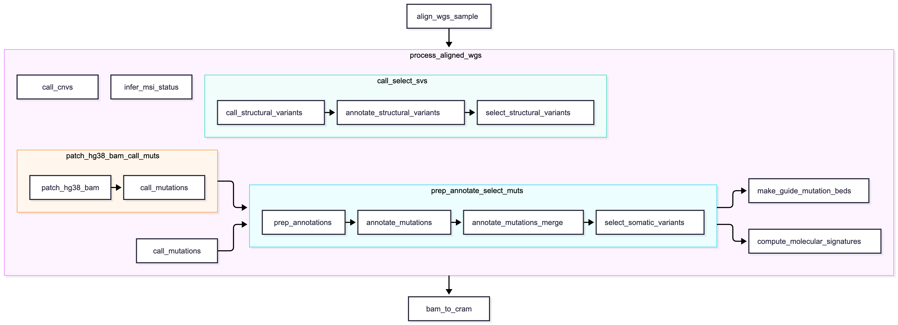

# Process aligned WGS

Master workflow that processes an aligned WGS BAM by calling all active subworkflows.

## Workflow graph

This [Mermaid](https://mermaid.live) diagram shows the complete WGS processing graph:

Note that `align_wgs_sample` and `bam_to_cram` are separate from `process_aligned_wgs`.
